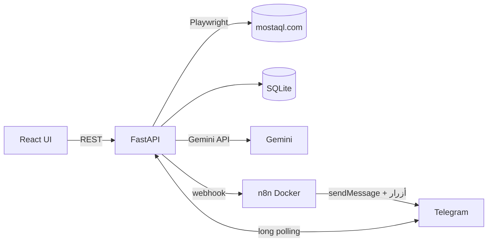

# 01 — التحليل والمعمارية (رادار مستقل)

## 1. الفكرة
أداة شخصية تسحب المشاريع الجديدة من منصة مستقل (حسابك أنت)، تقيّم ملاءمتها لمهاراتك بالذكاء الاصطناعي (Gemini)، تنبّهك عبر تيليجرام، وتكتب لك مسودة عرض تعتمدها أو ترفضها بزر قبل أن تقدّمها بنفسك.

## 2. قرارات المستخدم (من جلسة الأسئلة)
| البند | القرار |
|---|---|
| الأهداف | تنبيهات مشاريع جديدة + مسودات عروض + تحليل السوق (إحصاءات خفيفة) |
| المستخدمون | مستخدم واحد (أنت) — بدون نظام حسابات |
| نطاق السحب | الصفحات العامة + صفحات حسابك (عروضي) |
| التحديث | يدوي بزر (بدون جدولة) |
| التشغيل | FastAPI + React على ويندوز مباشرة، n8n داخل Docker |
| قاعدة البيانات | SQLite |
| الواجهة | React (Vite) عربي RTL، مظهر واحد |
| الذكاء الاصطناعي | Gemini: تقييم الملاءمة، التصنيف والتلخيص، كتابة مسودة العرض |
| الواجهة تعرض | قائمة مشاريع بفلاتر + سجل العروض |
| بوت تيليجرام | إشعارات + أوامر تفاعلية + أزرار موافقة/رفض |
| التسليم | المشروع كاملاً دفعة واحدة |

## 3. النطاق
**داخل النطاق (v1):** سحب القائمة والتفاصيل، مزامنة «عروضي» لمعرفة ما قدّمت عليه، تقييم AI، إشعارات، مسودات عروض، موافقة/رفض من تيليجرام أو الويب، سجل العروض، إحصاءات للأمر `/stats`.

**خارج النطاق عمداً:**
- **الإرسال التلقائي للعرض على مستقل.** يخالف شروط المنصة غالباً وهو أكثر ما يعرّض الحساب للحظر. «الموافقة» تعني أن النظام يعطيك النص النهائي والرابط لتقدّمه يدوياً.
- تعدد المستخدمين، الجدولة التلقائية، لوحة تحليل السوق الكاملة، الوضع الداكن.

## 4. المتطلبات الوظيفية
1. زر «تحديث» يسحب أول N صفحات من قائمة المشاريع (افتراضياً 2) ويحفظ الجديد.
2. للمشاريع الجديدة: سحب صفحة التفاصيل (بحد أقصى لكل تحديث).
3. سحب صفحة «عروضي» (إن وُجدت جلسة دخول) وتعليم المشاريع المقدَّم عليها.
4. تقييم كل مشروع جديد: درجة 0–100، سبب مختصر، ملخص، تصنيف.
5. إشعار تيليجرام للمشاريع التي درجتها ≥ العتبة (افتراضياً 70) بحد أقصى لكل تحديث.
6. من الإشعار: «اكتب عرضاً» ← مسودة ← «موافقة / رفض» ← «تم الإرسال».
7. الواجهة: فلاتر (بحث، تصنيف، درجة، ميزانية، حالة)، تفاصيل المشروع، محرر المسودة، سجل العروض.
8. أوامر البوت: `/latest` `/top` `/search` `/stats` `/refresh` `/draft`.

## 5. المتطلبات غير الوظيفية
- **سحب مهذّب:** فواصل عشوائية 3–7 ثوانٍ، لا تزامن، حد أقصى لعدد الصفحات.
- **الخصوصية:** لا تُخزَّن كلمة المرور؛ فقط ملف جلسة (cookies) محلي.
- **الأمان:** البوت يتجاهل أي دردشة غير `TELEGRAM_CHAT_ID`؛ نص المشاريع يُعامل كبيانات غير موثوقة في موجّه الذكاء الاصطناعي.
- **الصمود:** إذا تعطّل n8n يرسل FastAPI التنبيه مباشرة لتيليجرام؛ وإذا تعطّل Gemini يعمل مقيّم احتياطي بالكلمات المفتاحية.

## 6. المعمارية

**لماذا هذا التقسيم؟**
- FastAPI يملك «العقل»: السحب، التقييم، قاعدة البيانات، ومعالجة ضغطات أزرار تيليجرام عبر *long polling* فلا تحتاج رابطاً عاماً.
- n8n يملك «التوجيه والإخراج»: يستقبل Webhook من FastAPI ويرسل الرسائل لتيليجرام. تعديل الصيغة أو إضافة قنوات يتم بصرياً.
- n8n Telegram Trigger يحتاج Webhook عاماً بـ HTTPS، لذلك لم نعتمد عليه لاستقبال الأوامر.

## 7. نموذج البيانات
- **projects**: id، mostaql_id (فريد)، title، url، description، category، budget_min/max، proposals_count، status (`new|seen|applied|ignored`)، has_my_proposal، ai_score، ai_summary، ai_reason، notified، first_seen_at.
- **proposals**: id، project_id، draft_text، status (`draft|approved|sent|rejected`)، bid_amount، duration_days، created_at.
- **refresh_runs**: id، status، new_count، notified_count، error، started_at، finished_at.

## 8. تسلسل «تحديث»
أنت ← `POST /api/refresh` ← سحب القائمة ← تفاصيل الجديد ← عروضي ← تقييم Gemini ← Webhook إلى n8n ← رسائل تيليجرام بأزرار ← ضغط «اكتب عرضاً» (polling) ← مسودة Gemini ← موافقة/رفض.

## 9. المخاطر والحلول
| الخطر | الحل |
|---|---|
| منع الأتمتة في شروط مستقل (حظر الحساب) | سحب بطيء، يدوي، قليل الصفحات، بدون إرسال تلقائي |
| تغيّر تصميم الموقع | محلل مبني على الروابط `/project/<id>` + سكربت فحص + اختبارات |
| حاجز Cloudflare/CAPTCHA | كشف الحاجز وإيقاف التحديث برسالة واضحة؛ تسجيل دخول يدوي لحفظ الجلسة |
| حدود Gemini | سقف تقييمات لكل تحديث + مقيّم احتياطي |
| Prompt injection من وصف المشروع | فصل التعليمات عن البيانات + إخراج JSON منظم |

## 9.1 ملاحظة صدق
المحلل **لم يُختبر على صفحات مستقل الحية** لأن بيئة البناء لا تصل للموقع من الشل. اختُبر على صفحات اختبار مبنية على الشكل المتوقع. افحص النتيجة عند أول تشغيل بـ `scripts/inspect_page.py`.

## 10. خارطة الطريق
- v1.1: صفحة إعدادات للملف الشخصي والكلمات المفتاحية.
- v1.2: لوحة تحليل السوق.
- v2: جدولة، وإرسال شبه تلقائي اختياري.
